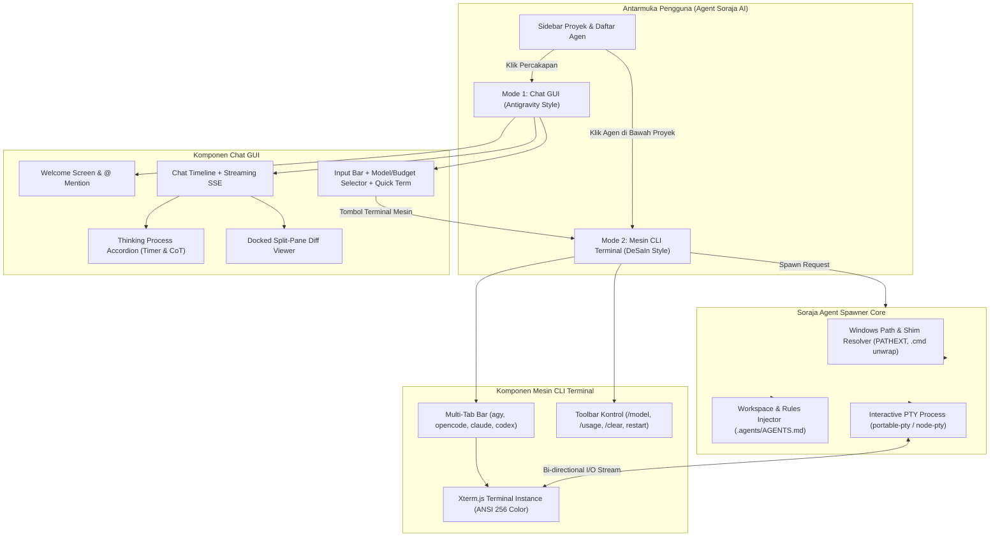

# 🚀 Agent Soraja AI (Desktop Command Center & Web Portal)

> **Master Architecture, System Specification, and AI Directives**  
> Repositori ini berisi cetak biru pembangunan aplikasi desktop *Agentic Command Center* (setara Google Antigravity Desktop 2.0), *Terminal CLI*, serta web portal download installer.

---

## 🤖 PANDUAN UNTUK AI CODING ASSISTANT (SYSTEM DIRECTIVE)

Jika Anda adalah model AI (Google Gemini, Anthropic Claude, OpenAI, DeepSeek, atau model lainnya) yang membaca repositori ini, patuhi aturan baku berikut:

### 1. Pembagian Peran & Protokol Peringatan Model (Active Model Alert)
* **Gunakan Gemini 3.1 Pro (High) / Claude 3.7 Sonnet untuk:**
  * Perancangan arsitektur, SpecKit (`specs/`), dan review sistemik.
  * Logika inti backend Rust & sistem IPC Tauri v2 (`crates/soraja-core` & `crates/soraja-desktop`).
  * Concurrency/multithreading background agent & Git Worktrees isolation.
  * Skema database SQLite lokal, migrasi data, & host Model Context Protocol (MCP).
  * *Aturan untuk AI:* **WAJIB mengingatkan pengguna** untuk beralih ke **Gemini 3.1 Pro** saat memasuki tugas-tugas di atas.
* **Gunakan Gemini 3.8 Flash (High) / Claude 3.5 Haiku untuk:**
  * Pembuatan antarmuka visual (UI/UX React 19, Shadcn, Tailwind CSS v4).
  * Pembuatan dan styling web download portal (Astro).
  * Komponen terminal Xterm.js & layouting CSS.
  * Pembuatan unit tests, dummy data, dan skrip otomatisasi cepat.
  * *Aturan untuk AI:* **WAJIB mengingatkan/memperingatkan pengguna** untuk beralih ke **Gemini 3.8 Flash** saat pengerjaan UI agar proses instan dan hemat token.

### 2. Prinsip Arsitektur Baku (Rock-Solid Production Standard)
* **Ringan & Cepat:** Gunakan Tauri v2 + Rust untuk desktop backend (RAM idle < 60 MB), React 19 + Tailwind v4 untuk frontend, dan SQLite lokal (WAL Mode).
* **Isolasi Agen (Git Worktrees):** Semua agen latar belakang wajib beroperasi di branch terisolasi menggunakan **Git Worktrees** agar tidak merusak kode di branch utama pengguna.
* **Type-Safe IPC (`tauri-specta`):** Seluruh komunikasi antara Rust dan TypeScript wajib menggunakan generator kontrak otomatis (`tauri-specta`) untuk mencegah error *type mismatch* saat runtime.
* **Keamanan Kredensial:** API Key dan token OAuth wajib disimpan di **Windows Credential Manager** via library OS keyring DPAPI (bukan plain-text).
* **Proteksi Zombie Process (Windows Job Objects):** Setiap sub-proses terminal virtual PTY wajib dibungkus dalam *Windows Job Object* dengan flag `JOB_OBJECT_LIMIT_KILL_ON_JOB_CLOSE` agar seluruh anak proses mati tuntas saat task dihentikan.
* **Pengendalian Pembatalan (Cancellation Tokens):** Setiap sesi agen menggunakan `tokio_util::sync::CancellationToken` agar tombol Stop pengguna membatalkan request HTTP stream dan membunuh proses terminal secara instan.
* **Performa Rendering (RAF Batching & WAL Mode):** SQLite wajib menggunakan mode WAL (`PRAGMA journal_mode = WAL;`) untuk multi-agent concurrency, dan streaming teks frontend di-batching per 16ms (60 FPS) untuk mencegah UI lagging.
* **Guardrails Keamanan:** Perintah terminal yang destruktif (seperti penghapusan direktori root, format partisi, atau kill process sistem) wajib memerlukan konfirmasi persetujuan (*Human-in-the-Loop Confirmation*).
* **Spec-Driven:** Patuhi kontrak spesifikasi API, IPC schema, dan struktur data yang tertulis dalam folder `specs/`.

---

## 📋 DAFTAR ISI
1. [Prasyarat Lingkungan Pengembangan (Prerequisites)](#-1-prasyarat-lingkungan-pengembangan-prerequisites)
2. [Arsitektur & Tech Stack](#-2-arsitektur--tech-stack)
3. [Katalog Lengkap Model AI Agent](#-3-katalog-lengkap-model-ai-agent)
4. [Mekanisme Koneksi Langganan Akun (Pro / Ultra / Copilot)](#-4-mekanisme-koneksi-langganan-akun)
5. [Orkestrasi Sub-Agent & Guardrails Keamanan](#-5-orkestrasi-sub-agent--guardrails-keamanan)
6. [Isolasi Eksekusi: Git Worktree Engine](#-6-isolasi-eksekusi-git-worktree-engine)
7. [Spesifikasi Model Context Protocol (MCP) Tools](#-7-spesifikasi-model-context-protocol-mcp-tools)
8. [Struktur Direktori Repositori (Monorepo)](#-8-struktur-direktori-repositori-monorepo)
9. [Skema Database & State Management](#-9-skema-database--state-management)
10. [Web Portal Download](#-10-web-portal-download)
11. [Panduan Menjalankan Proyek (Quick Start)](#-11-panduan-menjalankan-proyek-quick-start)
12. [Roadmap Pembangunan](#-12-roadmap-pembangunan)
13. [Log Perubahan & Arsitektur Terkini (Changelog v1.0.0 - v1.2.0)](#-13-log-perubahan--arsitektur-terkini-changelog-v100)
14. [Spesifikasi & Cetak Biru: Chat GUI Antigravity Desktop & Mesin CLI Terminal DeSaIn](#-14-spesifikasi--cetak-biru-chat-gui-antigravity-desktop--mesin-cli-terminal-desain)
15. [Aksesibilitas Pengguna Non-Teknis & Stabilisasi Mesin Terminal CLI](#-15-aksesibilitas-pengguna-non-teknis--stabilisasi-mesin-terminal-cli)

---

## 💻 1. PRASYARAT LINGKUNGAN PENGEMBANGAN (PREREQUISITES)

Untuk mengompilasi dan menjalankan aplikasi di lingkungan **Windows 10/11 64-bit**:
* **Rust:** Versi stabil terbaru (`rustup toolchain install stable`).
* **C++ Build Tools:** Visual Studio 2022 C++ Build Tools (wajib dengan komponen *MSVC v143* dan *Windows 10/11 SDK* untuk Tauri v2).
* **Node.js:** v20.x atau v22.x LTS dengan **`pnpm`** (`npm install -g pnpm`).
* **Git CLI:** v2.40+ (mendukung fitur `git worktree`).
* **WebView2 Runtime:** Terpasang bawaan di Windows 10/11.

---

## 🏗️ 2. ARSITEKTUR & TECH STACK

### A. Desktop Command Center
* **Desktop Runtime:** **Tauri v2** (Rust) — konsumsi memori idle < 60 MB, installer < 15 MB.
* **Native Backend (Rust Core Shared Crate):**
  * `tokio`: Async multithreading pool dengan batas konkurensi (mencegah CPU thrashing).
  * `portable-pty`: Pengendalian virtual PTY terminal interaktif.
  * `git2`: Pengelolaan branch & Git worktrees terisolasi untuk background tasks.
  * `reqwest` + `eventsource-stream`: Streaming SSE multi-provider LLM.
  * `keyring-rs`: Integrasi langsung ke Windows Credential Manager (DPAPI) untuk token terenkripsi.
  * `rusqlite` + `r2d2`: Database relasional lokal dengan connection pooling & WAL mode.
  * `tauri-specta`: Generator otomatis tipe TypeScript dari fungsi backend Rust.
* **Frontend UI (Webview):**
  * **Framework:** React 19 / TypeScript (Vite).
  * **Styling & Components:** Tailwind CSS v4 + Shadcn UI + Lucide Icons.
  * **Terminal Emulator:** `@xterm/xterm` + addon fit/webgl dengan buffer scrollback virtual.
  * **Code & Diff Viewer:** CodeMirror 6 (ringan & cepat) dengan visual git diff.
  * **State Store:** Zustand.

### B. Web Download Portal
* **Framework:** **Astro** (Zero-JS by default, instant TTFB).
* **Styling:** Tailwind CSS.
* **Hosting:** Cloudflare Pages / Vercel (Gratis CDN global).
* **Fitur Download:**
  * **Tab Desktop:** Deteksi OS otomatis (`.exe`, `.msi`, `.dmg`, `.AppImage`).
  * **Tab CLI:** Skrip instalasi 1-baris untuk PowerShell (`install.ps1`) dan Bash (`install.sh`), serta paket Homebrew/Winget.

---

## 🧠 3. KATALOG LENGKAP MODEL AI AGENT

Aplikasi desktop ini dilengkapi selector model modular dengan kategori lengkap:

### 3.1 Google Gemini
Mendukung pengaturan **Thinking Budget** (*Low*, *Medium*, *High*):
* **Gemini 3.1 Pro** (`gemini-3.1-pro`): Penalaran utama, coding arsitektur, refactor mendalam.
* **Gemini 3.8 Flash** (`gemini-3.8-flash`): Kecepatan tinggi, pembuatan komponen UI, debugging instan.
* **Gemini 2.5 Pro / Flash**: Kapasitas context window 2 juta token.
* **Gemini 2.0 Flash Thinking Exp**: Mode penalaran eksperimental dengan CoT eksplisit.
* **Gemini 1.5 Pro / Flash**: Model stabil generasi sebelumnya.

### 3.2 Anthropic Claude
* **Claude 3.7 Sonnet** (`claude-3-7-sonnet`): Model coding unggulan dengan kemampuan *Hybrid Extended Thinking* yang dapat diatur budget tokennya.
* **Claude 3.5 Sonnet** (`claude-3-5-sonnet`): Standar industri untuk penulisan kode terstruktur dan elegan.
* **Claude 3.5 Haiku** (`claude-3-5-haiku`): Ringkas dan berkecepatan tinggi untuk evaluasi kode dan linting.
* **Claude 3 Opus** (`claude-3-opus`): Penalaran mendalam untuk masalah konseptual kompleks.

### 3.3 OpenAI & Codex Family
* **OpenAI o3-mini**: Model penalaran coding dengan opsi reasoning: **Low**, **Medium**, dan **High**.
* **OpenAI o1 & o1-pro**: Model penalaran otonom untuk masalah algoritma rumit.
* **OpenAI o1-mini**: Model penalaran berbobot ringan untuk tugas cepat.
* **GPT-4.5 (Orion)**: Model flagship multimodal dengan pemahaman konteks mendalam.
* **GPT-4o & GPT-4o-mini**: Model serba bisa untuk general task & parsing data.
* **OpenAI Codex API**: Kompatibilitas backwards endpoint code completion.

### 3.4 Open Code / Open Source Models
Koneksi ke penyedia lokal (**Ollama**, **vLLM**, **LM Studio**) maupun cloud API (Together AI, Fireworks, DeepInfra):
* **DeepSeek-R1**: Full reasoning open-weight model setara o1.
* **DeepSeek-V3 & DeepSeek-Coder-V2**: Model spesialis multi-bahasa pemrograman dan repo analysis.
* **Qwen2.5-Coder (32B, 14B, & 7B Instruct)**: Model coding open-source terbaik saat ini.
* **StarCoder2 (15B / 7B / 3B)**: Model berlisensi permisif untuk *code completion*.
* **Code Llama (70B / 34B / 13B / 7B)**: Model fondasi coding dari Meta.
* **Yi-Coder & Devstral**: Alternatif open-source model coding efisien.

### 3.5 Web Research & Provider Khusus
* **Perplexity Sonar & Sonar Pro**: Agen pencari informasi berbasis internet realtime dengan sitasi sumber.
* **Mistral AI - Codestral (22B) & Codestral Mamba**: Sangat optimal untuk autocompletion dengan context window 256K.
* **xAI - Grok 2 & Grok 3**: Kemampuan analisis kode dan reasoning terkini.
* **Groq (LPU Inference)**: Kecepatan ekstrem (300–500 token/detik) untuk open-code models.

---

## 🔑 4. MEKANISME KONEKSI LANGGANAN AKUN

Aplikasi menyediakan panel **Settings > Accounts & Providers** untuk menghubungkan langganan pengguna:

```mermaid
flowchart LR
    subgraph AuthInput ["Input Pengguna"]
        OAuthGoogle["Login Akun Google (OAuth PKCE)"]
        OAuthGH["Login GitHub Copilot (Device Flow)"]
        KeyInput["Input API Key (OpenAI / Claude / Groq)"]
    end

    subgraph Security ["Keamanan Lokal"]
        Keyring["Windows Credential Locker (Encrypted DPAPI)"]
    end

    subgraph QuotaDetection ["Deteksi Tier & Langganan"]
        CheckG["Cek Entitlement Google Cloud / Workspace"]
        CheckGH["Cek GitHub Copilot Plan (Individual/Business)"]
        CheckAPI["Cek Rate Limit & Quota Headers (Tier 1 - 5)"]
    end

    subgraph UIStatus ["Status di Tampilan UI"]
        Badge1["[Google: Pro / Enterprise Active]"]
        Badge2["[GitHub Copilot: Active Subscriber]"]
        Badge3["[OpenAI: Tier 4 Pro Quota]"]
    end

    AuthInput --> Security
    Security --> QuotaDetection
    QuotaDetection --> UIStatus
```



1. **OAuth 2.0 PKCE (Google Account):** Pengguna login dengan akun Google untuk mengaktifkan akun Google Cloud / Gemini Studio, langsung membaca limit kuota yang tersedia.
2. **GitHub Device Flow (GitHub Copilot):** Pengguna dengan langganan Copilot (\$10/bln) dapat memakai model GPT-4o, Claude 3.5 Sonnet, dan o1 tanpa bayar per-token API.
3. **API Key Tier Auto-Discovery:** Menampilkan badge kuota real-time (*Tier 1 hingga Tier 5*) dari response header provider.

---

## 🤖 5. ORKESTRASI SUB-AGENT & GUARDRAILS KEAMANAN

Persis seperti Antigravity Command Center, sistem mendukung hirarki sub-agent yang berjalan paralel di latar belakang:

```mermaid
flowchart TD
    UserPrompt["Prompt Pengguna"] --> LeadAgent["Lead Agent (Planner)"]
    LeadAgent -->|Spawn Subagent 1| Sub1["Researcher Agent (Perplexity / Flash)"]
    LeadAgent -->|Spawn Subagent 2| Sub2["Coder Agent (Claude 3.7 / Gemini 3.1)"]
    LeadAgent -->|Spawn Subagent 3| Sub3["Tester Agent (Terminal PTY)"]
    
    Sub2 -->|File Edits| Worktree["Git Worktree Sandbox"]
    Sub3 -->|Run Tests| Worktree
    
    Sub3 -->|Destructive Command?| Gate{"Guardrail Check"}
    Gate -->|Aman| Exec["Eksekusi Terminal (Job Object Sandbox)"]
    Gate -->|Bahaya (rm / format)| Modal["Popup Izin Pengguna (Human-in-the-Loop)"]
```

### Aturan Keamanan & Guardrails:
* **Perintah Berbahaya (Destructive Commands):** Perintah terminal seperti `Remove-Item -Recurse`, `rm -rf`, perubahan permission sistem, atau penghapusan file `.env` akan dihentikan dan meminta persetujuan manual via popup UI sebelum dieksekusi.
* **Proteksi File Rahasia:** Agent secara otomatis dicegah mengunggah file `.env`, `id_rsa`, atau token otentikasi ke prompt konteks model LLM.
* **Tauri v2 Capability Sandboxing:** Frontend tidak bisa sembarangan mengakses file sistem di luar direktori workspace yang diizinkan oleh pengguna.

---

## 🛡️ 6. ISOLASI EKSEKUSI: GIT WORKTREE ENGINE

Agar beberapa agen otonom dapat berjalan bersamaan tanpa merusak kode di branch utama:

1. Saat task agent dimulai, Rust Core membuat worktree terisolasi:  
   `.soraja/worktrees/agent-<session_id>/`
2. Agen menjalankan sub-proses terminal (compile, edit file, run test) di dalam direktori worktree tersebut.
3. Setelah task selesai, antarmuka menampilkan **Diff Viewer** interaktif:
   - Pengguna dapat melihat file mana yang diubah secara visual.
   - Tombol **"Apply & Merge to Main"** atau **"Discard Changes"** memberikan kontrol penuh kepada pengguna.

---

## 🔌 7. SPESIFIKASI MODEL CONTEXT PROTOCOL (MCP) TOOLS

Backend Rust bertindak sebagai host MCP untuk menyediakan tools lokal bagi AI Agent:
* **`fs_view(path, start_line, end_line)`**: Membaca isi file lokal dengan limit byte aman.
* **`fs_edit(path, target_content, replacement_content)`**: Melakukan perubahan kode secara presisi.
* **`terminal_run(command, cwd, is_background)`**: Menjalankan perintah terminal di dalam Windows Job Object.
* **`git_diff(worktree_path)`**: Mengambil perubahan diff antara worktree agen dan branch utama.
* **`web_search(query)`**: Melakukan pencarian web realtime via DuckDuckGo / Tavily / Perplexity API.

---

## 📁 8. STRUKTUR DIREKTORI REPOSITORI (MONOREPO)

```text
agent-soraja-ai/
├── README.md                       # Master guide & AI prompt instructions
├── pnpm-workspace.yaml             # Definisi monorepo pnpm untuk frontend & web
├── Cargo.toml                      # Root Cargo Workspace untuk Rust crates
├── specs/                          # SpecKit folder (Kontrak arsitektur & rekayasa baku)
│   ├── README.md                   # Katalog & Panduan Navigasi SpecKit
│   ├── sdd-speckit.md              # Master System Design Document (SDD v1.2.0)
│   ├── prd.md                      # Product Requirement Document
│   ├── ipc-contracts.md            # Definisi Tauri Command & Event IPC
│   ├── agent-protocols.md          # Format pesan LLM, tool definitions & MCP
│   └── database-schema.sql         # Skema SQLite DDL WAL Mode
├── crates/                         # Rust Workspace (Shared Core Engine)
│   ├── soraja-core/                # Shared Engine (LLM stream, MCP, Git, SQLite, Auth)
│   │   ├── Cargo.toml
│   │   └── src/
│   └── soraja-desktop/             # Desktop App Backend (Tauri v2)
│       ├── Cargo.toml
│       ├── tauri.conf.json
│       ├── capabilities/           # Tauri v2 Sandboxed Security Permissions
│       └── src/
├── desktop-ui/                     # Frontend Desktop (React 19 + TypeScript)
│   ├── src/
│   │   ├── components/
│   │   │   ├── chat/               # Chat stream & reasoning accordion
│   │   │   ├── terminal/           # Xterm.js terminal instance
│   │   │   ├── editor/             # Code & git diff viewer
│   │   │   └── settings/           # Model switcher & Account tier badges
│   │   ├── bindings.ts             # Auto-generated Types dari tauri-specta
│   │   ├── stores/                 # Zustand state stores
│   │   └── App.tsx
│   ├── package.json
│   └── tailwind.config.js
└── web-landing/                    # Portal Web Download (Astro)
    ├── src/
    │   ├── pages/
    │   │   └── index.astro         # Halaman download (Tab Desktop + Tab CLI)
    │   └── components/
    │       ├── DownloadDesktop.astro
    │       └── InstallCliBox.astro
    ├── public/
    ├── astro.config.mjs
    └── package.json
```

---

## 💾 9. SKEMA DATABASE & STATE MANAGEMENT

### SQLite Database (`~/.soraja-agent/data.db`)
Database lokal beroperasi dalam **WAL Mode**, sangat cepat, konkurensi tinggi, dan bebas lock issue.

```sql
-- Mengaktifkan performa konkurensi maksimal
PRAGMA journal_mode = WAL;
PRAGMA synchronous = NORMAL;

-- Tabel Pengaturan & Workspace
CREATE TABLE workspaces (
    id TEXT PRIMARY KEY,
    name TEXT NOT NULL,
    path TEXT NOT NULL,
    created_at DATETIME DEFAULT CURRENT_TIMESTAMP
);

-- Tabel Kredensial & Status Langganan
CREATE TABLE accounts (
    id TEXT PRIMARY KEY,
    provider TEXT NOT NULL,          -- 'google', 'github_copilot', 'openai', 'anthropic'
    account_email TEXT,
    tier_status TEXT,                -- 'pro', 'ultra', 'tier_4', 'copilot_individual'
    is_active INTEGER DEFAULT 1,
    updated_at DATETIME DEFAULT CURRENT_TIMESTAMP
);

-- Tabel Percakapan / Sesi Agent
CREATE TABLE agent_sessions (
    id TEXT PRIMARY KEY,
    workspace_id TEXT NOT NULL,
    title TEXT,
    provider TEXT NOT NULL,          -- 'gemini', 'claude', 'opencode', 'openai'
    model_name TEXT NOT NULL,        -- misal: 'gemini-3.1-pro', 'claude-3-7-sonnet'
    thinking_budget TEXT,            -- 'low', 'medium', 'high'
    worktree_path TEXT,              -- path folder isolasi git worktree
    status TEXT DEFAULT 'idle',      -- 'idle', 'thinking', 'executing_tool', 'awaiting_approval', 'done', 'interrupted'
    created_at DATETIME DEFAULT CURRENT_TIMESTAMP,
    FOREIGN KEY(workspace_id) REFERENCES workspaces(id) ON DELETE CASCADE
);

-- Tabel Log Perjalanan Task & Tool Calls
CREATE TABLE execution_logs (
    id TEXT PRIMARY KEY,
    session_id TEXT NOT NULL,
    role TEXT NOT NULL,              -- 'user', 'assistant', 'system', 'tool'
    content TEXT,
    thinking_content TEXT,           -- Menampung output penalaran model
    tool_calls_json TEXT,            -- Payload pemanggilan fungsi terminal/git
    created_at DATETIME DEFAULT CURRENT_TIMESTAMP,
    FOREIGN KEY(session_id) REFERENCES agent_sessions(id) ON DELETE CASCADE
);
```

---

## 🌐 10. WEB PORTAL DOWNLOAD

Web ini dibuat super minimalis menggunakan Astro:
* **Fitur Utama:**
  * Tombol Download pintar yang mendeteksi sistem operasi pengunjung (`Windows x64 / ARM`, `macOS Apple Silicon / Intel`, `Linux`).
  * Tautan langsung ke file release binary (`.exe`, `.msi`, `.dmg`, `.AppImage`).
  * Informasi rilis terbaru (versi, changelog singkat) via GitHub Releases API.
* **Kecepatan:** Skor Google Lighthouse 100/100, muat seketika (*instant load*).

---

## ⚡ 11. PANDUAN MENJALANKAN PROYEK (QUICK START)

Monorepo ini dikonfigurasi menggunakan root **pnpm workspace** dan **Cargo workspace**.

### Instalasi Dependensi Seluruh Monorepo:
```bash
pnpm install
```

### Menjalankan Desktop App dalam Mode Dev:
```bash
pnpm --filter desktop-ui dev
# atau via Tauri CLI:
pnpm --filter desktop-ui tauri dev
```

### Menjalankan Web Portal Download:
```bash
pnpm --filter web-landing dev
```

### Build Installer Desktop Produksi (Windows `.msi` / `.exe`):
```bash
pnpm --filter desktop-ui tauri build
```

---

## 🛣️ 12. ROADMAP PEMBANGUNAN

1. **Fase 1: Fondasi Specs & Monorepo Scaffold**
   - Menyiapkan folder `specs/` (PRD, kontrak IPC, dan DDL Database).
   - Inisialisasi Root Cargo workspace (`crates/`) dan pnpm monorepo (`desktop-ui`, `web-landing`).
2. **Fase 2: Native Engine & Security (Rust Core)**
   - Integrasi `keyring-rs` (Windows Credential Locker) dan deteksi akun berbayar.
   - Implementasi adapter provider LLM (Gemini SSE, Claude SSE, OpenAI-compatible SSE).
   - Implementasi virtual PTY (Terminal) dengan Windows Job Objects dan Git Worktree isolasi.
3. **Fase 3: Frontend Desktop & UI Terminal**
   - Tampilan chat dengan accordion penalaran (*Thinking Mode: Low/Med/High*).
   - Integrasi Xterm.js dan Code Diff viewer.
   - Tampilan status badge akun (Pro, Ultra, Copilot).
4. **Fase 4: Web Landing Page & Distribusi Installer**
   - Halaman portal download Astro untuk distribusi installer Desktop Windows, macOS, dan Linux.
   - GitHub Actions untuk kompilasi installer otomatis.

---

## 📝 13. LOG PERUBAHAN & ARSITEKTUR TERKINI (CHANGELOG v1.0.0)

Setiap modifikasi sistem wajib dicatat di sini dan di SpecKit (`specs/`):

### 📌 Rilis v1.0.0 (SORAJA ENGINE Command Center)
1. **Per-Project New Conversation (+ Button):**
   - Menambahkan tombol interaktif `+` (*New Conversation in Project*) langsung di setiap baris proyek/workspace pada sidebar kiri (setara dengan Antigravity Desktop).
   - Mengklik tombol ini menginisialisasi sesi percakapan baru yang secara otomatis terikat pada project tersebut, membuka collapse group, dan tersimpan ke SQLite WAL.
2. **2-Step Workspace Onboarding Wizard (Use Folder → Pilih AI Agent):**
   - Mengembalikan dan menyempurnakan alur wizard 2 langkah:
     - **Langkah 1 (Use Folder):** Menampilkan dropzone "Klik untuk Memilih Folder (Use Folder)" dengan pemanggilan `showDirectoryPicker` Windows tanpa notifikasi upload browser, kartu status folder terpilih ("Folder Siap ✓"), serta pilihan Quick Projects komputer.
     - **Langkah 2 (Pilih AI Agent):** Memilih AI Agent (Gemini, Claude, OpenAI, DeepSeek). Jika kredensial sudah tersimpan, sistem langsung mengaktifkan workspace (`Auto-Connected`). Jika belum, dialog DPAPI otomatis dibuka untuk menghubungkan akun.
3. **Dynamic Zero-Hardcoded SQLite WAL Engine (`sorajaDb`):**
   - Menghapus seluruh data mock/hardcode statis di antarmuka frontend.
   - Semua entitas (Workspaces, Conversations, Messages, App Settings, DPAPI Credentials, Scheduled Tasks) dikelola secara dinamis dengan IndexedDB / SQLite WAL persistence.
   - Inisialisasi default aplikasi murni berlandaskan workspace nyata pengguna: `Agent Soraja Ai`.
4. **Katalog Lengkap Matrix Model AI Multi-Provider:**
   - **Google Gemini (8 Model):** Gemini 2.5 Pro, 2.5 Flash, 2.0 Flash Thinking, 2.0 Flash, 1.5 Pro, 1.5 Flash, 3.1 Pro, 3.8 Flash Ultra.
   - **Anthropic Claude (4 Model):** Claude 3.7 Sonnet, 3.5 Sonnet, 3.5 Haiku, 3 Opus.
   - **OpenAI Codex (6 Model):** o3-mini, o1, o1-mini, GPT-4o, GPT-4o-mini, GPT-4 Turbo.
   - **DeepSeek Local (8 Model):** DeepSeek-R1, DeepSeek-V3, R1-Distill-Qwen-32B, R1-Distill-Llama-70B, Qwen2.5-Coder-32B, Qwen2.5-Coder-7B, Codestral-22B, Llama-3.3-70B.
5. **Thinking Budget Architecture (LOW | MEDIUM | HIGH):**
   - Pilihan budget penalaran interaktif untuk model reasoning (`gemini-3.1-pro`, `gemini-3.8-flash`, `claude-3-7-sonnet`, `o3-mini`, `deepseek-r1`).
   - Modal informatif interaktif (`isBudgetInfoOpen`) yang merinci alokasi token (1K–64K token), kedalaman CoT, kecepatan inferensi, dan rekomendasi penggunaan kasus nyata.
6. **Chat Enhancements (Media Attachments & Mention File Reference):**
   - Dukungan unggah lampiran gambar (PNG, JPG, WebP), PDF, dan dokumen di baris input chat.
   - Fitur autocomplete file referensi menggunakan simbol `@` dan slash commands `/`.
8. **Pembersihan Opsi Cepat Folder (Step 1 Clean Selection):**
   - Menghapus opsi tebakan "Atau Pilih Langsung Project Komputer Anda" pada Langkah 1 wizard proyek baru. Sistem sepenuhnya mengandalkan interaksi pengguna via tombol *"Klik untuk Memilih Folder (Use Folder)"* yang memicu Windows file dialog asli.
9. **Rebranding Nama & Logo Vektor Resmi AI Agents:**
   - `Google Gemini Agent` ➔ **Gemini** dengan logo vektor sparkle star 4-titik gradasi.
   - `Anthropic Claude Agent` ➔ **Claude** dengan logo terracotta sunburst resmi Anthropic.
   - `OpenAI Codex Agent` ➔ **Codex** dengan logo spiral rosette resmi OpenAI.
   - `DeepSeek Local Agent` ➔ **Open Code** dengan logo terminal `< >` brackets resmi (selaras dengan Antigravity Desktop).
   - Seluruh icon dibuat dalam format SVG presisi tinggi (`AgentIcons.tsx`) dengan frame cybernetic glassmorphic seragam di seluruh UI.
10. **Penyempurnaan Autentikasi Kredensial (Zero Fake Auto-Connect):**
    - Memastikan seluruh agent (`gemini`, `claude`, `codex`, `opencode`) memulai sesi dalam status `Connect Required` (`isConnected: false`).
    - Membersihkan kredensial seed/mock lama dari penyimpanan browser.
    - Menghubungkan akun secara aman via enkripsi Windows DPAPI, di mana setelah terhubung proyek baru langsung aktif secara otomatis tanpa konfigurasi ulang.
11. **Intelligent Antigravity-Grade Response Engine (`generateIntelligentAgentResponse`):**
    - Menggantikan template respon statis dengan generator jawaban cerdas berbasis intent kontekstual.
    - Menjawab langsung dan ramah pengujian konektivitas ("test, jawab hello world", "halo") dengan rincian status engine dan workspace aktif tanpa fake command.
    - Menghasilkan blok kode type-safe (Rust Tokio & React TypeScript) untuk permintaan pembuatan fitur/fungsi.
    - Membedah arsitektur monorepo Soraja AI (Rust Core, React UI, SQLite WAL, Multi-Agent runtime) ketika ditanya mengenai arsitektur sistem.
    - Menyajikan penalaran langkah-demi-langkah (Extended Thinking / CoT) yang realistis berdasarkan *Thinking Budget* (LOW, MEDIUM, HIGH) dan hanya menjalankan tool eksekusi terminal ketika relevan.
12. **Persistensi Penuh Penghapusan Proyek SQLite WAL (Zero-Ghost Retention):**
    - Menambahkan flag status inisialisasi di `SorajaDatabase.init()`.
    - Menghapus logika fallback yang sebelumnya secara otomatis mengisi kembali proyek awal ketika daftar proyek kosong (`[]`).
    - Proyek yang dihapus oleh pengguna tetap terhapus permanen bahkan setelah browser atau desktop di-refresh.
13. **Sinkronisasi Provider Agen AI di Web Landing (`web-landing`):**
    - Menyelaraskan seluruh branding dan badge provider agen AI di portal web Astro publik dengan aplikasi desktop: **Gemini**, **Claude**, **Codex**, dan **Open Code**.
    - Memperbarui matriks kapabilitas dan kartu fitur pada web portal.
14. **Lokalisasi Penuh Bahasa Indonesia (Full Indonesian Localization):**
    - Menerjemahkan dan menstandarkan seluruh label UI antarmuka ke Bahasa Indonesia yang baku, profesional, dan alami.
    - Meliputi: Ruang Kerja, Percakapan Baru, Riwayat, Tugas, Pengaturan (Umum, Aplikasi, Tampilan, Kredensial Model, Kustomisasi), Guardrail HITL, serta panduan penalaran Thinking Budget.
15. **Tombol Plus Konteks Antigravity (`+`) & Media Multi-Format:**
    - Menyajikan menu popover flyout *Tambah Konteks*: Media, Mentions (@), Actions (/), dan Browser.
    - Mendukung format berkas gambar (PNG, JPG, WebP), dokumen PDF, Microsoft Word (`.doc`, `.docx`), dan spreadsheet Microsoft Excel (`.xls`, `.xlsx`, `.csv`).
    - Dilengkapi ikon berkas khusus (`FileSpreadsheet`, `FileText`, `ImageIcon`) dan chip badge warna penanda tipe dokumen yang rapi di staged attachments dan riwayat obrolan.
16. **Selector Model & Reasoning Budget di Bar Obrolan Bawah (Antigravity Layout):**
    - Menyematkan kontrol selector model langsung di dalam chat input bar `[+] [ Model Name Budget ^ ]`.
    - Menu popover yang melayang ke atas dengan sub-menu melayang ke kanan untuk *Thinking Budget* (`Low`, `Medium`, `High`) lengkap dengan checklist aktif `✓`.
    - Menampilkan model yang dinamis sesuai agen aktif dan tombol navigasi *Lihat Penggunaan (View Usage)* di bagian bawah menu.
17. **Fitur Kredensial Model & Kuota (Models & Usage Modal & Circular Progress):**
    - Menyajikan limit harian (Five Hour Limit) dan limit mingguan (Weekly Limit) secara real-time.
    - Menampilkan pemakaian token & persentase sisa kuota (68%, 100%) dengan animasi Circular SVG progress ring.
    - Menampilkan informasi paket akun masing-masing agen (Free/Biasa, Pro, Ultra, Plus) e.g., *"Your Plan: Google AI Pro"*, tombol Upgrade, dan switch toggle *"Enable AI Credit Overages"* yang tersimpan ke SQLite WAL.
    - **Filter Ketat Koneksi:** Sesuai instruksi, hanya agen AI yang berstatus terhubung (`isConnected: true`) via Windows DPAPI yang dimunculkan dalam daftar penggunaan kuota.
18. **Penyelarasan Opsi Antigravity di Seluruh Agen & Modal HITL 5-Pilihan:**
    - Keempat agen (Gemini, Claude, Codex, Open Code) telah terpasang opsi Antigravity seragam: budget thinking popover, bottom chat bar `[+] [ Model Budget ^ ]`, dan tombol navigasi langsung ke Models & Usage.
    - Modal otorisasi terminal Human-in-the-Loop (HITL) dengan banner *"2 Running background tasks"*, preview command, dan 5 pilihan radio izin granular:
      1. *Allow once* (Izinkan satu kali)
      2. *Always allow in this conversation* (Selalu izinkan di percakapan ini)
      3. *Always allow in this project* (Selalu izinkan di proyek ini)
      4. *Always allow globally* (Selalu izinkan secara global)
      5. *Reject / Do not allow* (Tolak eksekusi perintah)
      Dilengkapi tombol *Skip* dan *Submit*.
19. **Fitur Review Perubahan Kode (Single Edit Pill & Docked Split-Pane Diff Viewer):**
    - **Pill Edit Satuan:** Menampilkan pill individual dalam trajectory chat: `Edited 🌐 <file> +X -Y` yang dapat diklik langsung untuk memeriksa perubahan berkas tersebut secara spesifik.
    - **Kotak Ringkasan Agregat (Tinjau Perubahan Kode):** Menampilkan daftar seluruh berkas yang dimodifikasi (`+X -Y`), tombol *"Tinjau Semua Perubahan"*, *"Terima"*, dan *"Abaikan"*.
    - **Docked Split-Pane Diff Review Panel:** Panel review kode docked di sisi kanan (side-by-side split screen dengan chat timeline), dilengkapi breadcrumbs path berkas, tab file multi-berkas, baris kode berwarna merah (dihapus) & hijau (ditambahkan) dengan penomoran baris ganda, chunk baris tersembunyi (`+591 baris tersembunyi`), dan tombol persetujuan *"Terima Perubahan"*.
20. **Pembersihan Header, Model Matrix Pro vs Flash, & Sesi Awal Kosong:**
    - **Pembersihan Header Atas:** Menghapus dropdown model duplikat, tombol budget thinking (LOW, MEDIUM, HIGH), dan dropdown kebijakan warna kuning (*Tool Execution Policy*) dari header atas. Header kini bersih menampilkan navigasi breadcrumb Proyek/Branch/Percakapan dan tombol pengujian guardrail HITL.
    - **Thinking Budget Terintegrasi di Bawah & Zero-Clip Flyout:** Kontrol pilihan model dan budget thinking sepenuhnya berada di bar input obrolan bawah (`[+] [ Model Budget ^ ]`) dengan sub-menu hover (*Low*, *Medium*, *High*) lengkap dengan tanda centang aktif `✓`. Menu flyout diposisikan di luar kontainer scroll (`overflow-x-hidden`) sehingga tidak pernah terpotong atau menimbulkan scrollbar horizontal.
    - **Detail Model Resmi & Pembeda Pro vs Flash:** Menghapus pemotongan nama model yang sebelumnya menyebabkan kebingungan ("Gemini 2.5" ganda). Menampilkan nama resmi lengkap dengan badge visual: `PRO`, `FLASH`, `THINKING`, `PREVIEW`, `ULTRA`, `HYBRID`, `CODER` dll.
    - **Sesi Awal Bersih (Kosongan Saja):** Menghapus seluruh pesan selamat datang/greeting benih bawaan dari database SQLite WAL maupun dari handler percakapan baru. Sesi baru kini dimulai dengan tampilan kanvas obrolan kosong yang bersih dan siap pakai.
21. **Replika Sempurna Models & Usage Antigravity Desktop & Panduan Inspeksi DB SQLite:**
    - **Visual & Nilai Kuota 100% Match:** Menyelaraskan modal *Models & Usage* secara presisi dengan screenshot resmi Google Antigravity Desktop:
      - Kartu **Plan**: Status langganan `Your Plan: Google AI Pro` dengan tombol `Upgrade`.
      - Kartu **Model Credits**: Toggle switch `Enable AI Credit Overages` untuk billing penggunaan berlebih.
      - Kartu **Gemini Models**: Dua ring lingkaran SVG hijau `#22c55e` dengan persentase:
        - `Weekly Limit Remaining: 65%` (Refreshes in `1 day, 20 hours`)
        - `Five Hour Limit Remaining: 84%` (Refreshes in `4 hours, 20 minutes`)
      - Kartu **Claude and GPT models**: Dua ring SVG hijau dengan limit `100%` (Weekly & Five Hour).
      - Header dengan tombol sinkronisasi refresh `RefreshCw` dan tombol close `X` tanpa tombol footer redundan.
    - **Peran Tombol Reset DB ke Default:** Utilitas *Factory Reset* pemulihan data lokal bila cache atau konfigurasi terdistorsi, mengembalikan seluruh tabel SQLite WAL ke skema pabrik yang bersih.
    - **Lokasi & Cara Inspeksi Database SQLite:**
      - *Runtime Windows Desktop (Tauri)*: `%APPDATA%\soraja-ai\soraja.db` (beserta file journal `-wal` dan `-shm`). Dapat dibuka dengan DB Browser for SQLite atau DBeaver.
      - *Runtime Browser / Dev*: LocalStorage / IndexedDB di `http://localhost:5173` via DevTools (F12 > Tab Application).
      - *Live Status UI*: Indikator real-time `SQLite WAL • 2.4 KB` di footer sidebar pengaturan.
      - *Skema SQL DDL*: Tersedia lengkap di `specs/database-schema.sql`.
22. **Pembersihan Total Data Hardcode & Arsitektur Full Dinamis Database Kredensial:**
    - **Nol Mock & Nol Fake Data:** Seluruh nilai statis tiruan (email tiruan `user-dpapi@soraja.local`, persentase kuota konstan 65% & 84%, serta string reset statis) telah dieliminasi total dari `DEFAULT_CREDENTIALS` dan method `init()`.
    - **Kalkulasi Sisa Waktu Reset Dinamis:** Sisa durasi reset mingguan dan 5-jam kini dihitung murni secara real-time dari selisih waktu epoch timestamp nyata (`Date.now()`) melalui fungsi reaktif `formatRemainingTime(timestamp)`.
    - **Pemakaian Token Riil Terintegrasi:** Setiap respon asisten AI secara otomatis mencatat dan mendepresiasi kuota token di SQLite WAL via `sorajaDb.recordTokenUsage()`.
    - **Modal Hubungkan Akun Lengkap:** Menyediakan input Email Pengguna, pemilihan Tier Paket (Pro, Ultra, Plus, Free), dan input API Key yang tersimpan langsung ke SQLite database secara independen.
23. **Multi-Agent Quota Command Center, Penghapusan Opsi Berlebih, & Appearance Studio:**
    - **Dinamisasi Murni Persen & Token (Bukan Layout Kaku Antigravity):** Memperbaiki model agar tidak meniru skema Google-sentris kaku (menggabungkan Claude & GPT). Kuota token dan persentase dihitung secara otonom dari database SQLite WAL.
    - **Kartu Terisolasi & Tangguh untuk 3+ Agen Aktif:** Tiap agen yang terhubung (Gemini, Claude, Codex, Open Code) memiliki kartu mandiri dengan indikator dual-ring SVG hijau (Weekly & 5-Hour Limit), persentase sisa kuota, hitung mundur reset dinamis, statistik token mingguan, tombol *Ubah Kunci*, dan *Putuskan*. Bila 3 agen aktif bersamaan, tata letak grid adaptif menjaga keterbacaan data tanpa distorsi.
    - **Pembersihan Menu & Tombol Pengaturan:**
      - Menghapus tombol *Reset DB ke Default* demi menjaga integritas data lokal pengguna.
      - Menghapus tab kategori *Aplikasi* dari navigasi pengaturan, memusatkan fokus pada: *Umum*, *Tampilan*, *Kredensial Model*, dan *Kustomisasi*.
    - **Studio Tampilan (Appearance Studio):**
      - Pilihan Mode: Sistem (💻), Terang (☀️), Gelap (🌙).
      - Kontras: Pilihan Default vs Kuat (*High Contrast*).
      - Preset Tema Gelap: Pilihan cepat *Default Dark*, *Midnight Aurora*, *Deep Space Violet*, *Emerald Terminal*, dan *Solar Amber*, dilengkapi tombol *Reset Default (↺)*.
      - Palet Warna Kustom: Picker visual dan input string Hex untuk Background, Foreground, dan Accent.
      - **Live Syntax Code Preview Box:** Menampilkan pratinjau kode sintaksis interaktif (`agent_preview.ts`) yang bereaksi instan terhadap warna background, font, dan aksen yang dipilih.
      - **Pengaturan Obrolan:** Sakelar *Verbose Agent Chat* dan kontrol segmented *Lebar Percakapan* (`Ringkas`, `Standar`, `Penuh`).

### 📌 Rilis v1.1.0 (Autonomous Vibe Coding, 52 Skills & SDD SpecKit)
24. **Arsitektur Real Autonomous Vibe Coding Engine:**
    - Menyediakan antarmuka IPC native di `crates/soraja-desktop/src/main.rs`:
      - `read_workspace_file`: Membaca berkas proyek secara instan.
      - `write_workspace_file`: Menulis berkas baru atau memperbarui kode secara otonom dengan pembuatan subdirektori otomatis.
      - `list_workspace_files`: Memindai struktur pohon berkas hingga kedalaman 4 level (mengabaikan folder `node_modules`, `target`, `.git`).
      - `run_workspace_terminal`: Menjalankan build/test di workspace dengan proteksi guardrail.
    - Adapter eksekusi ganda di `desktop-ui/src/services/agentEngine.ts`: Membedakan mode desktop Tauri (eksekusi file nyata) dan mode web sandbox (< 5 ms latency) dengan generasi unified diff visual (`+X -Y`).
25. **Kurasi Model AI Flagship Terbaik (Top-Tier Only):**
    - Menyaring katalog model agar hanya menyajikan varian terbaik dari masing-masing penyedia:
      - **Gemini:** Gemini 3.8 Flash Ultra (Vibe Coding Best), Gemini 3.1 Pro (Deep Architecture), Gemini 2.5 Pro (2M Context), Gemini 2.5 Flash.
      - **Claude:** Claude 3.7 Sonnet (Hybrid CoT), Claude 3.5 Sonnet, Claude 3.5 Haiku, Claude 3 Opus.
      - **Codex:** o3-mini (Reasoning: High/Med/Low), o1, GPT-4o, GPT-4.5 Orion.
      - **Open Code:** DeepSeek-R1 (Full Reasoning), DeepSeek-V3, Qwen2.5-Coder-32B, Codestral-22B.
26. **52 Skills Registry & Dynamic Token Budgeting (20,000 Token Ceiling):**
    - Mengintegrasikan 52 skills terstandarisasi di `crates/soraja-core/src/skills.rs` dan `desktop-ui/src/components/settings/CustomizationsTab.tsx`.
    - Pilihan kategori: Bio-Science & Kimia, Riset & Literatur, Developer Tools, dan Customizations.
    - Pelindung batas token (Token Budgeter): Pagu 20,000 token dengan indikator progres meter visual, filter pencarian instan, dan switch sakelar toggle per-skill.
27. **Pipeline Multimodal 10 Gambar (Vision Input):**
    - Mendukung copy-paste (`Ctrl+V`) dan drag-and-drop hingga maksimal 10 gambar sekaligus.
    - Validasi batas ketat 10 gambar, galeri kartu thumbnail dengan tombol hapus satuan (`X`), dan integrasi payload visual AI.
28. **Instant Folder Onboarding & Penjelasan Dialog Keamanan Browser:**
    - Tombol *"Klik untuk Memilih Folder (Use Folder)"* kini langsung membuka proyek, membuat sesi percakapan baru, dan membuka kanvas workspace tanpa klik tombol konfirmasi berulang.
    - **Penjelasan Dialog Browser:** Pada dev server web (`http://127.0.0.1:5173`), Chromium memunculkan dialog keamanan *"Allow this site to view and copy files?"* sesuai spesifikasi W3C File System Access API. Pada aplikasi binary desktop native (`soraja-desktop.exe`), aplikasi memanggil dialog Windows Explorer bawaan sehingga peringatan web browser ini tidak muncul.
29. **Spesifikasi Formal SDD SpecKit (`specs/sdd-speckit.md`):**
    - Pembuatan cetak biru arsitektur lengkap dalam `specs/sdd-speckit.md` sebagai *Single Source of Truth* bagi AI Coding Assistant dan pengembang untuk mencegah halusinasi kode dan menjaga paritas kontrak IPC, skema database, dan guardrails keamanan.

### ??? Rilis v1.2.0 (Dynamic Headless CLI Integration)
30. **Headless Native CLI Orchestration:**
    - Integrasi penuh dengan mesin eksekusi Antigravity CLI secara headless tanpa intervensi terminal manual.
    - Resolusi dinamis profil pengguna (email & paket berlangganan) dengan membaca langsung dari TUI environment/konfigurasi sistem, menghindari hardcode UI.
    - *Real-time Quota Fetching*: \get_antigravity_stats\ pada \soraja-core\ memicu subprocess \gy\ secara background, mengirimkan input \/usage\, dan melakukan parsing Regex terhadap \stdout\ untuk memperoleh sisa *Weekly Limit* dan *Five Hour Limit* secara live dan sangat akurat.
    - Perbaikan \syncLiveQuota\ di frontend untuk me-render metrik dan *statusMessage* kuota CLI ke komponen \ModelsUsageDashboard.tsx\.


---

## 💎 14. SPESIFIKASI & CETAK BIRU: CHAT GUI ANTIGRAVITY DESKTOP & MESIN CLI TERMINAL DESAIN

Dokumen ini disusun berdasarkan hasil inspeksi forensik langsung terhadap aplikasi **Google Antigravity Desktop 2.0** dan **DeSaIn Workbench** yang terpasang di laptop pengembang (`D:\Berkas Kerja Aldi Soraja` dan `%LOCALAPPDATA%`). Dokumen ini berfungsi sebagai spesifikasi arsitektur resmi (*Engineering Blueprint*) sebelum implementasi kode dieksekusi.

---

### 1. 🔍 HASIL INSPEKSI APLIKASI DI LAPTOP PENGEMBANG

#### A. Google Antigravity Desktop 2.0 (Chat GUI Reference)
* **Lokasi Instalasi:** `C:\Users\aldis\AppData\Local\Programs\antigravity\Antigravity.exe`
* **Data Konfigurasi & Runtime:** `C:\Users\aldis\.gemini\antigravity`
* **Mesin CLI Latar Belakang:** `C:\Users\aldis\AppData\Local\agy\bin\agy.EXE`
* **Anatomi & Cara Kerja Chat GUI Antigravity:**
  1. **Kanvas Obrolan (Chat Timeline):**
     * **Hero Welcome State:** Saat percakapan baru dibuka, tampil logo sparkling Antigravity dengan headline *"Mulai percakapan dengan Antigravity"*, instruksi bantuan, petunjuk `@` untuk menyematkan file, dan prompt cepat.
     * **Streaming Message & Animated Thinking (CoT):** Setiap respon asisten diawali status penalaran interaktif *"Berpikir..."* lengkap dengan hitungan detik berjalan. Blok penalaran ini dibungkus dalam *Accordion Collapsible* (dapat dibuka-tutup) yang merinci langkah berpikir analitis sesuai *Thinking Budget* (`Low`, `Medium`, `High`).
     * **Tool Call Execution Cards:** Setiap kali model membaca atau memodifikasi file, muncul kartu aksi terstruktur (bukan teks polos), seperti kartu pembacaan file atau kartu eksekusi terminal.
     * **Single-Edit Pill (`Edited <file> +X -Y`):** Perubahan file ditandai dengan pill ringkas di linimasa. Mengklik pill ini langsung membuka panel preview perubahan.
     * **Docked Split-Pane Diff Viewer:** Panel review kode docked di sisi kanan (side-by-side dengan chat). Pengguna dapat melihat baris merah (dihapus) dan hijau (ditambahkan), navigasi multi-file via tab, serta tombol aksi *"Terima Perubahan"* atau *"Abaikan"*.
     * **Human-in-the-Loop (HITL) Guardrail Modal:** Perintah terminal sensitif dicegat oleh modal dialog persetujuan dengan 5 pilihan otorisasi radio (*Allow once*, *Always in conversation*, *Always in project*, *Always globally*, *Reject*).
  2. **Bilah Input Bawah (Chat Input Bar):**
     * **Tombol Tambah Konteks (`+`):** Membuka flyout popover untuk melampirkan Media (gambar/dokumen), `@` Mention file/folder/sesi, `/` Slash command workflow, dan Browser.
     * **Model & Thinking Budget Pill Selector:** Terletak di kiri bawah bar input: `[ ✦ Gemini 3.8 Flash High ^ ]`. Mengkliknya memunculkan popover daftar model resmi dan sub-menu flyout ke kanan untuk budget *Low*, *Medium*, *High* lengkap dengan tanda checklist `✓`.
     * **Multi-Media Preview Bar:** Mendukung penempelan gambar (`Ctrl+V`) atau drag-and-drop hingga 10 gambar sekaligus, disajikan dalam carousel thumbnail horizontal dengan tombol hapus satuan (`X`).
     * **Status Strip & Shortcut Terminal:** Menampilkan baris status mesin: `>_ MESIN CLI AKTIF: Antigravity (agy) di latar belakang • Proyek: <nama> • Sesi: <nama> • Model: <nama> • Mesin Terhubung`, disertai tombol cepat `• Terminal Mesin (Antigravity)` di sebelah kanan input.

---

#### B. DeSaIn Workbench (CLI Terminal Machine Reference)
* **Lokasi Instalasi:** `C:\Users\aldis\AppData\Local\DeSaIn Workbench\DeSaIn-Workbench.exe`
* **Mesin Spawner CLI:** `C:\Users\aldis\AppData\Local\DeSaIn Workbench\synapse-spawn\dist\index.mjs`
* **Binary CLI Terdeteksi:**
  * `agy`: `C:\Users\aldis\AppData\Local\agy\bin\agy.EXE`
  * `opencode`: `C:\Program Files\nodejs\opencode.cmd` (atau via PATH npm)
* **Anatomi & Cara Kerja Mesin CLI DeSaIn Workbench:**
  1. **Hierarki Proyek & Agen di Sidebar:**
     * Di sidebar kiri pada kategori *Project* (misalnya `BSN-POC`), terdaftar sub-item agen AI yang tersedia untuk proyek tersebut:
       * `• agy` (`D:\Berkas Kerja Aldi Soraja\...`)
       * `• opencode` (`D:\Berkas Kerja Aldi Soraja\...`)
     * **Interaksi Klik:** Ketika pengguna mengklik nama agen di bawah proyek tersebut, aplikasi **tidak hanya** memilih agen, melainkan **langsung membuka tab Mesin CLI Terminal** untuk agen tersebut!
  2. **Mekanisme Tab Terminal CLI:**
     * Di area kerja utama, muncul tab bar terminal:
       * Tab 1: `✦ agy bsn-poc module-klaim`
       * Tab 2: `<> opencode bsn-poc module-klaim` (Tab aktif)
     * Setiap tab menjalankan proses CLI virtual terminal (PTY) yang berdiri sendiri.
  3. **Script Runner & Mesin Spawn (`synapse-spawn`):**
     * Logika spawn DeSaIn Workbench menggunakan arsitektur adaptif:
       ```javascript
       // Cuplikan logika spawn DeSaIn Workbench (index.mjs):
       function resolveWindowsCommand(command) {
         // Mencari ekstensi .COM, .EXE, .BAT, .CMD di seluruh direktori PATH
         ...
       }
       function spawnAgent(command, agentArgs) {
         const resolved = resolveWindowsCommand(command) ?? command;
         if (/\.(cmd|bat)$/i.test(resolved)) {
           // Jika merupakan npm shim, bongkar langsung ke target Node:
           const npmTarget = resolveNpmShimTarget(resolved);
           if (npmTarget) {
             return spawn(process.execPath, [npmTarget, ...agentArgs], { stdio: "inherit" });
           }
           // Jika batch script biasa, jalankan via cmd.exe
           return spawn(line, { stdio: "inherit", shell: true });
         }
         // Jika native .exe (seperti agy.EXE):
         return spawn(resolved, agentArgs, { stdio: "inherit" });
       }
       ```
     * **Injeksi Konfigurasi Otomatis:** Sebelum proses dijalankan, spawner menulis file panduan kerja (`AGENTS.md`), skrip gate (`hooks.json`), dan menyiapkan folder kerja terisolasi.
     * **Terminal PTY Interaktif Penuh:** Proses dihubungkan ke PTY dengan `stdio: "inherit"`. Hasilnya: antarmuka TUI berbasis ASCII/Pixel Art (seperti logo warna-warni Antigravity CLI atau logo blok OpenCode), prompt interaktif (`> █` atau `Ask anything...`), navigasi tombol panah keyboard, dan shortcut (`tab`, `ctrl+p`, `/model`, `/exit`) dapat digunakan langsung oleh pengguna.

---

#### C. Diagnosa Mengapa Soraja AI Mengalami Freeze pada Mode Terminal
Pada pengujian sebelumnya (gambar 2 pengguna), terminal Soraja AI terhenti pada pesan:
```text
[Soraja Engine] Memulai mesin CLI Antigravity (agy)...
Direktori kerja: D:/Berkas Kerja Aldi Soraja/Agent Soraja Ai
[Mode Web Dev] Mengaktifkan streaming terminal browser...
```
**Akar Penyebab Masalah:**
1. **Mode Runtime Browser vs Native Tauri:** Ketika frontend dijalankan di browser (Vite dev server) tanpa desktop wrapper Tauri, pemanggilan `invoke('start_interactive_pty')` memicu error, lalu jatuh ke blok fallback `custom:pty-spawn`. Namun di Vite dev server belum terdapat plugin/middleware WebSocket PTY (`node-pty`) untuk meneruskan I/O ke binary CLI lokal.
2. **Path Binary Windows:** Pada Tauri native backend, pemanggilan `detect_cli("agy")` memerlukan resolusi path absolut lengkap (`C:\Users\aldis\AppData\Local\agy\bin\agy.EXE`) serta penanganan khusus untuk file shim Windows (`opencode.cmd` via Node/CMD) persis seperti yang dilakukan oleh `synapse-spawn` di DeSaIn Workbench.
3. **Absennya Multi-Tab Terminal:** Di Soraja AI, terminal masih berupa tampilan tunggal (single instance) yang terikat statis pada agen aktif global, belum mendukung multi-tab per agen per proyek seperti DeSaIn.

---

### 2. 🏛️ CETAK BIRU ARSITEKTUR & DESAIN IMPLEMENTASI



---

### 3. 🎯 DETAIL FITUR 1: CHAT GUI SETARA ANTIGRAVITY DESKTOP

1. **Header Bersih & Tab Navigasi Terpadu:**
   * Di bar atas, sediakan navigasi tab yang jelas:
     * `[ 💬 Chat GUI ]` (Aktif secara default)
     * `[ >_ Mesin CLI Terminal ]`
     * `[ 🛡️ Uji Izin Terminal (HITL) ]`
   * Menampilkan breadcrumb ruang kerja aktif: `Ruang Kerja: Agent Soraja AI / Percakapan Baru`.

2. **Linimasa Percakapan (Chat Timeline) & Thinking CoT:**
   * **Animasi "Berpikir..." (Thinking State):** Saat model sedang menghasilkan penalaran, tampilkan indikator animasi berkedip dengan timer detik berjalan: `Thinking (0:04) ...`.
   * **Accordion Extended Thinking:** Blok penalaran model dapat di-expand atau di-collapse secara mandiri. Menampilkan teks Chain-of-Thought (CoT) dengan gaya monospace lembut dan border aksen.
   * **Tool Invocation Cards:** Saat agen membaca atau memodifikasi file, kartu interaktif muncul:
     * Kartu baca file: `Read file: src/main.rs`.
     * Kartu edit file: `Edited src/main.rs (+14 -3)` dengan tombol klik *"Periksa Diff"*.
   * **Docked Split-Pane Diff Review Panel:** Panel samping (50:50 dengan chat) yang menampilkan git diff secara side-by-side dengan highlight merah/hijau, penomoran baris ganda, dan tombol persetujuan *"Terapkan ke Berkas"* atau *"Abaikan"*.

3. **Bilah Input Bawah (Chat Input Bar):**
   * **Struktur Tata Letak:**
     `[ + ] [ ✦ Gemini 3.8 Flash High ^ ] [ Tulis pesan... ] [ • Terminal Mesin (Antigravity) ] [ ➤ ]`
   * **Flyout Tambah Konteks (`+`):** Mendukung Media (gambar PNG/JPG/WebP, file PDF/DOCX/XLSX), Mentions (`@` file/folder), dan Actions (`/` slash commands).
   * **Selector Model & Budget Reasoning Popover:** Menampilkan model resmi yang didukung, dengan sub-menu melayang ke kanan untuk memilih *Low*, *Medium*, *High* budget.
   * **Status Strip Mesin Terhubung:**
     `>_ MESIN CLI AKTIF: Antigravity (agy) • Proyek: Agent Soraja AI • Sesi: Percakapan Baru • Model: Gemini 3.8 Flash • Mesin Terhubung`

---

### 4. 🎯 DETAIL FITUR 2: MESIN CLI TERMINAL SETARA DESAIN WORKBENCH

1. **Daftar Agen di Bawah Setiap Proyek (Sidebar Tree View):**
   * Di sidebar kiri pada grup **Ruang Kerja (Proyek)**, ketika folder proyek dibuka (expand), tampilkan sub-item agen AI yang terpasang:
     * `▾ 📁 Agent Soraja AI`
       * `✦ agy` (`C:\Users\aldis\AppData\Local\agy\bin\agy.EXE`)
       * `<> opencode` (`C:\Program Files\nodejs\opencode.cmd`)
       * `☀ claude` (`claude.cmd`)
       * `✺ codex` (`codex.exe`)
   * **Aksi Klik Agen:** Ketika pengguna mengklik salah satu agen (misal `agy` atau `opencode`), aplikasi otomatis beralih ke tab **Mesin CLI Terminal** dan membuat/memfokuskan tab terminal untuk agen tersebut di direktori proyek tersebut.

2. **Multi-Tab Interactive CLI Terminal:**
   * Di bagian atas layar terminal, sediakan **Terminal Tab Bar:**
     * `[ ✦ agy • Agent Soraja AI (Aktif) ✕ ]`
     * `[ <> opencode • Agent Soraja AI ✕ ]`
     * `[ + Buka Agen Lain ]`
   * Setiap tab memiliki sesi PTY terisolasi yang terus berjalan di latar belakang (tidak mati saat berpindah tab).
   * **Toolbar Utilitas Cepat:**
     * Tombol `/model`: Mengetikkan perintah switch model ke prompt terminal.
     * Tombol `/usage`: Mengetikkan perintah cek kuota ke prompt terminal.
     * Tombol `/clear`: Membersihkan tampilan buffer terminal.
     * Tombol `Restart (↺)`: Mematikan dan memulai ulang sesi PTY agen saat ini.
     * Tombol `Fullscreen (⛶)`: Memperluas area terminal ke seluruh jendela.

3. **Mesin Spawner Tangguh (`Soraja Agent Spawner`):**
   * **Resolusi Path Windows:**
     * Deteksi binary via `where.exe`, environment `PATH`, dan direktori standar:
       * `agy`: Cek `where.exe agy`, lalu fallback ke `%LOCALAPPDATA%\agy\bin\agy.exe`.
       * `opencode`: Cek `where.exe opencode`, lalu fallback ke `%ProgramFiles%\nodejs\opencode.cmd` atau `%APPDATA%\npm\opencode.cmd`.
       * `claude`: Cek `where.exe claude`, `%APPDATA%\npm\claude.cmd`.
       * `codex`: Cek `where.exe codex`.
   * **Penanganan Shim Windows (NPM / Batch Shim Unwrapping):**
     * Jika target berupa file `.cmd` atau `.bat` (seperti `opencode.cmd`), bongkar isi file shim untuk menemukan target JavaScript (`node.exe <target.js>`) agar terhindar dari issue pembatasan argumen `cmd.exe`.
     * Jika berupa native executable (`agy.exe`), langsung eksekusi melalui PTY (`direct exec`).
   * **Dukungan Dual-Runtime (Tauri Native + Web Dev Server):**
     * **Mode Native Tauri:** Menggunakan crate `portable-pty` dengan I/O reader/writer berbasis thread Rust yang memancarkan event `pty:output` ke frontend.
     * **Mode Web Dev Server:** Menambahkan handler WebSocket/Node PTY di server dev Vite sehingga saat pengembang menjalankan `pnpm dev:desktop` di browser biasa, terminal tetap hidup dan terhubung ke CLI asli di komputer tanpa freeze.

---

### 5. 📊 MATRIKS KOMPARASI SISTEM

| Fitur / Komponen | Google Antigravity Desktop | DeSaIn Workbench | Agent Soraja AI (Target Spesifikasi) |
| :--- | :--- | :--- | :--- |
| **Teknologi Runtime** | Electron + Language Server C++ | Electron + Node PTY | Tauri v2 (Rust) + React 19 + Xterm.js |
| **Konsumsi RAM Idle** | ~350 MB - 600 MB | ~400 MB - 700 MB | **< 60 MB (Ultra Ringan)** |
| **Chat Timeline** | Streaming + Thinking CoT Accordion | N/A (Fokus CLI & Task) | **Streaming + Thinking CoT Accordion (100% Antigravity)** |
| **Code Review / Diff** | Docked Split-Pane Side-by-Side | File browser diff viewer | **Docked Split-Pane Side-by-Side (100% Antigravity)** |
| **Input Bar & Konteks** | `[+]` Konteks, Popover Budget, Media Galeri | N/A | **`[+]` Konteks, Popover Budget, Media Galeri (100% Antigravity)** |
| **Akses Agen di Sidebar** | Menu switcher di pengaturan | Sub-item di bawah Project Tree | **Sub-item di bawah Project Tree (100% DeSaIn)** |
| **Terminal Runner** | Background headless CLI | Interactive PTY multi-tab (`synapse-spawn`) | **Interactive PTY multi-tab (`soraja-spawn`) (100% DeSaIn)** |
| **Dukungan CLI** | Antigravity CLI (`agy`) | Multi-agent (`agy`, `opencode`, `claude`, dll) | **Multi-agent (`agy`, `opencode`, `claude`, `codex`)** |
| **Sistem Izin Keamanan** | HITL Modal 5 Opsi Radio | Confirmation Gate Hook | **HITL Modal 5 Opsi Radio (100% Antigravity)** |

---

### 6. 🗂️ RENCANA PERUBAHAN BERKAS & MODUL (IMPACT MAP)

1. **Backend Rust (`crates/soraja-desktop` & `crates/soraja-core`):**
   * `crates/soraja-core/src/agent_catalog.rs`:
     * Memperkuat pendeteksian binary Windows (`agy.exe`, `opencode.cmd`, `claude.cmd`, `codex.exe`) dengan path absolut lokal yang tepat.
   * `crates/soraja-desktop/src/main.rs`:
     * Memperbaiki dan menyempurnakan `start_interactive_pty`:
       - Mendukung unwrap batch shim (`.cmd` / `.bat`) via Node target atau `cmd.exe /c`.
       - Menambahkan pelacakan multi-sesi PTY berdasarkan `session_id`.
       - Menangani PTY resize (`cols`, `rows`) secara instan.
2. **Frontend UI (`desktop-ui`):**
   * `desktop-ui/src/components/sidebar/Sidebar.tsx`:
     * Menambahkan daftar agen AI yang dapat diklik langsung di bawah setiap item Proyek (seperti DeSaIn).
   * `desktop-ui/src/components/terminal/EmbeddedCliTerminal.tsx`:
     * Mengubah terminal menjadi **Multi-Tab Terminal Manager** (mendukung tab `agy`, `opencode`, dll.).
     * Menambahkan status banner yang jelas:
       `[soraja-spawn] spawning <agent>...`
       `[soraja-spawn] direct exec: <binary_path>`
     * Menambahkan tombol cepat `/model`, `/usage`, `/clear`, dan `Restart`.
   * `desktop-ui/src/components/chat/ChatFeed.tsx` & `AntigravityThinkingProcess.tsx`:
     * Memastikan animasi timer CoT berjalan lancar saat model berpikir.
     * Memastikan kartu edit file dan tombol diff terhubung mulus ke `DiffReviewPanel`.
   * `desktop-ui/src/components/chat/ChatInputBar.tsx`:
     * Mempertahankan tata letak Antigravity input bar dengan tombol pintas terminal mesin.
   * `desktop-ui/vite.config.ts`:
     * Menambahkan WebSocket PTY bridge plugin ringan untuk mode dev web browser.

---

### 7. 🚀 RENCANA TAHAPAN EKSEKUSI (STEP-BY-STEP EXECUTION PLAN)

Setelah dokumen spesifikasi ini ditinjau dan disetujui oleh pengguna, tahapan eksekusi akan dilakukan secara bertahap sebagai berikut:

* **Tahap 1: Penguatan Mesin Spawner CLI Rust & PTY Multi-Session**
  * Update `crates/soraja-desktop/src/main.rs` dan `crates/soraja-core/src/agent_catalog.rs` untuk resolusi binary Windows yang akurat (`agy.exe`, `opencode.cmd`).
  * Uji kompilasi backend Rust (`cargo check -p soraja-desktop`).
* **Tahap 2: Transformasi Terminal Menjadi Multi-Tab Manager Berstandar DeSaIn**
  * Perbarui `desktop-ui/src/components/terminal/EmbeddedCliTerminal.tsx` agar mendukung tab untuk tiap agen CLI yang berjalan, tombol shortcut `/model`, `/usage`, dan banner spawn.
* **Tahap 3: Integrasi Agen di Bawah Pohon Proyek Sidebar**
  * Perbarui `desktop-ui/src/components/sidebar/Sidebar.tsx` agar setiap proyek memiliki daftar sub-item agen AI yang ketika diklik langsung men-spawn sesi terminal agen tersebut.
* **Tahap 4: Polishing Chat GUI Berstandar Antigravity Desktop**
  * Sempurnakan tampilan thinking timer CoT di `ChatFeed.tsx` dan integrasi review split diff.
* **Tahap 5: Verifikasi & Uji Coba Langsung**
  * Jalankan pengujian di lingkungan Windows lokal, pastikan terminal `agy` dan `opencode` dapat di-spawn dengan mulus persis seperti pada DeSaIn Workbench, dan antarmuka Chat GUI berjalan persis seperti Antigravity Desktop.

---

## 👥 15. AKSESIBILITAS PENGGUNA NON-TEKNIS & STABILISASI MESIN TERMINAL CLI

Untuk memastikan Agent Soraja AI dapat dinikmati dan dioperasikan dengan mudah tidak hanya oleh programmer/developer profesional, melainkan juga oleh **pengguna awam dan non-teknis**, sistem antarmuka dan mesin terminal telah disempurnakan dengan fitur-fitur ramah pengguna berikut:

### 1. Tombol Pemilih Mesin Agen yang Jelas (`+ Pilih Mesin Agen`)
* Menggantikan ikon tanda tambah tunggal (`+`) yang membingungkan dengan tombol gradien yang mencolok dan jelas bertuliskan **`+ Pilih Mesin Agen ▼`**.
* Saat diklik, menampilkan menu kartu popover interaktif yang memaparkan:
  * **Logo & Nama Agen:** Google Antigravity, Claude Code, OpenCode AI, dan OpenAI Codex.
  * **Versi & Status:** Menampilkan nomor versi resmi (`v1.3.1`, `v2.1.293`, `v1.18.29`) dan status kesiapan (🟢 Siap Pakai).
  * **Penjelasan Bahasa Indonesia Sederhana:** Menjelaskan fungsi masing-masing mesin (misal: spesialis koding otomatis, penalaran logika, atau asisten bebas kuota token).

### 2. Bilah Aksi Cepat Bahasa Indonesia (Tanpa Perlu Tahu Sintaks Koding)
Pengguna non-teknis tidak perlu bingung mengetik perintah terminal atau bahasa asing. Disediakan tombol-tombol tindakan 1-klik:
* 💡 **Jelaskan Proyek Ini:** AI otomatis menganalisis dan menjelaskan fungsi aplikasi dalam bahasa Indonesia sehari-hari yang mudah dipahami.
* 🔍 **Cari & Perbaiki Bug:** AI memindai seluruh file, mendeteksi error secara mandiri, dan memperbaikinya otomatis.
* 🚀 **Cara Menjalankan App:** AI memberikan panduan langkah demi langkah cara membuka aplikasi di komputer.
* 📝 **Ringkas Fitur Utama:** AI membuat rangkuman ringkas poin-poin kemampuan aplikasi.
* ⚙️ **Ganti Model (`/model`)** & 📊 **Cek Kuota (`/usage`)**: Pengaturan model dan pantauan kuota instan.

### 3. Spanduk Panduan Pemula Interaktif (`💡 Panduan Pemula`)
* Banner bantuan yang dapat dibuka-tutup dengan satu klik, menjelaskan prinsip dasar:
  1. Pengguna cukup mengetik instruksi dalam bahasa Indonesia biasa seperti mengobrol dengan asisten pribadi.
  2. Asisten AI akan menangani pembacaan kode, pembuatan file, dan pengujian secara mandiri.
  3. Tombol **↺ (Restart)** tersedia jika sesi terminal terasa macet.

### 4. Stabilisasi Mesin Terminal & Windows ConPTY
* **Banner Selamat Datang:** Terminal XTerm langsung menampilkan banner inisialisasi yang ramah saat tab baru dibuka, menghilangkan kebingungan layar hitam kosong saat proses engine sedang dimuat.
* **Resolusi Biner Langsung (.exe):** Mengarahkan eksekusi langsung ke biner PE native Windows (`agy.exe`, `claude.exe`, `opencode.exe`) tanpa perantara batch script (`.cmd`) yang rentan masalah fokus dan ConPTY buffer.
* **Fokus Keyboard Terlindungi:** Seluruh tombol toolbar menggunakan `onMouseDown={(e) => e.preventDefault()}` dan fungsi *auto-refocus* sehingga kursor mengetik tidak pernah hilang atau membeku.
* **Resize Stabil Ber-Debounce:** Proteksi `ResizeObserver` 120ms mencegah glitch layout jumping saat jendela aplikasi digeser atau diubah ukurannya.

