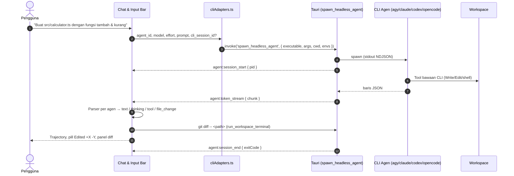
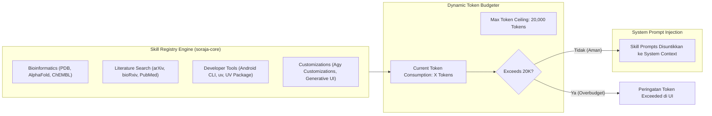
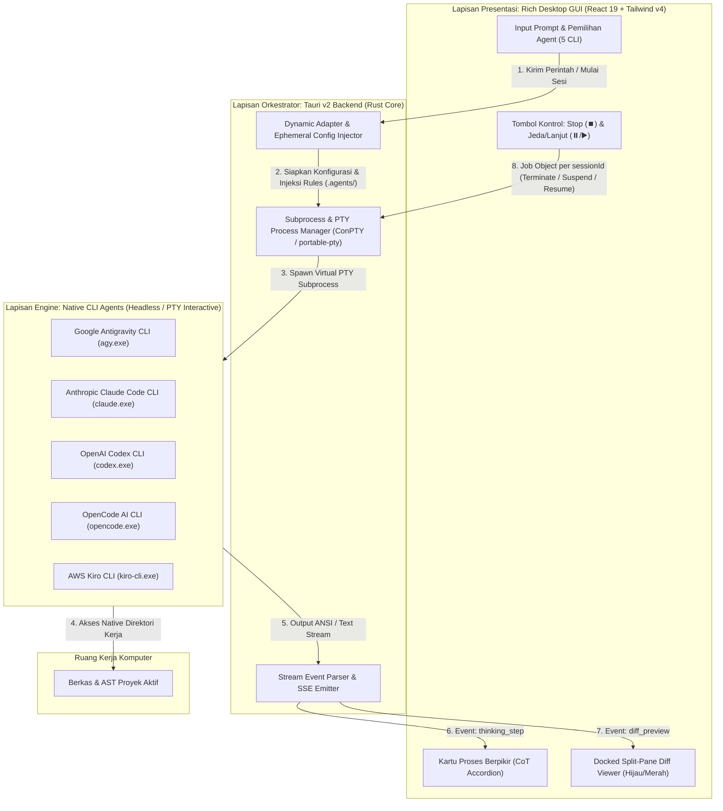

# 📐 System Design Document (SDD) & SpecKit: Agent Soraja AI

> **Status:** Production Ready  
> **Version:** 1.2.0  
> **Target OS:** Windows 10/11 64-bit  
> **Architecture Pattern:** Spec-Driven Modular Monolith with Rust Core & Tauri v2 Desktop  

---

## 1. Ringkasan Eksekutif & Visi Sistem

**Agent Soraja AI** adalah platform *Agentic Command Center* dan lingkungan *Vibe Coding* otonom lokal berkecepatan tinggi yang dirancang untuk menandingi Google Antigravity Desktop 2.0, Claude Code, dan Cursor. 

Sistem ini menyatukan **5 agen coding CLI resmi** — Antigravity (`agy`), Claude Code (`claude`), Codex (`codex`), OpenCode (`opencode`), dan Kiro (`kiro-cli`) — dalam dua mode: **Chat GUI** ala Antigravity Desktop (CLI headless + stream JSON) dan **Terminal CLI** yang identik dengan CLI aslinya (ConPTY + xterm.js). Soraja tidak mengimplementasikan agen sendiri; arsitektur acuan ada di §11 dan [`agent-protocols.md`](./agent-protocols.md).

### Mengapa SDD / SpecKit Ini Mutlak Diperlukan?
1. **Single Source of Truth untuk AI Coding Assistants:**  
   Ketika AI (seperti Gemini 3.1 Pro, Claude 3.7 Sonnet, atau Cursor) mengedit kode dalam repositori ini, ketiadaan spesifikasi formal menyebabkan halusinasi nama method IPC, struktur tabel database yang tidak konsisten, atau pelanggaran batas file (< 500 baris). SDD SpecKit ini berfungsi sebagai panduan baku yang tidak dapat diganggu gugat.
2. **Paritas Mode Chat GUI dan Terminal CLI:**  
   Menjamin bahwa kedua mode memakai biner CLI agen, folder workspace, dan (bila didukung CLI) sesi yang sama, dengan kontrak IPC yang tercatat di [`ipc-contracts.md`](./ipc-contracts.md). Tidak ada biner terminal milik Soraja (`soraja-cli` tidak dibuat).
3. **Kepatuhan Guardrail & Keamanan Sistem:**  
   Menstandarisasi alur proteksi Human-in-the-Loop (HITL) agar tidak ada perintah terminal berbahaya (`rm -rf`, format partisi) yang dapat dieksekusi tanpa otorisasi pengguna.

---

## 2. Prinsip Rekayasa Sistem & Kebutuhan Non-Fungsional (NFR)

* **Kecepatan Inferensi & Operasi (< 5ms Local IPC):** Operasi pembacaan berkas lokal, penulisan berkas, dan pemindaian pohon direktori dieksekusi secara instan melalui Rust `std::fs` tanpa overhead layer yang berat.
* **Batas Maksimal 500 Baris Per File (Separation of Concerns):** Seluruh berkas kode sumber baik di frontend TypeScript maupun backend Rust dilarang keras melampaui 500 baris. Komponen monolitik wajib didekomposisi menjadi sub-komponen terisolasi.
* **Zero-Lock Database Concurrency (SQLite WAL Mode) — target, belum tersambung (data UI masih di `localStorage`):** Database lokal beroperasi dengan `PRAGMA journal_mode = WAL;` dan `PRAGMA synchronous = NORMAL;`, memungkinkan multi-agent menulis log percakapan dan status tugas secara simultan tanpa table locking.
* **Isolasi Keamanan Kredensial (Windows DPAPI):** API Key dan token pengguna tidak pernah disimpan sebagai teks biasa (*plain text*) di disk, melainkan dienkripsi secara native oleh Windows Credential Manager.
* **Zero-Ghost Retention:** Seluruh aksi mutasi data (penghapusan proyek, percakapan, tugas) memiliki persistensi mutlak. Data yang dihapus tidak boleh muncul kembali saat aplikasi direfresh.

---

## 3. Topologi Monorepo & Batas Modul (Module Boundaries)

```
agent-soraja-ai/
├── specs/                          # [SpecKit] Kontrak Arsitektur & Spesifikasi Baku
│   ├── sdd-speckit.md              # Master System Design Document (Berkas Ini)
│   ├── prd.md                      # Product Requirement Document
│   ├── ipc-contracts.md            # Kontrak IPC Tauri & Specta Bindings
│   ├── agent-protocols.md          # State Machine & Protokol MCP Tools
│   └── database-schema.sql         # DDL Skema SQLite WAL
├── crates/                         # [Rust Workspace] Shared Native Core
│   ├── soraja-core/                # Shared Engine (katalog agen CLI, akun & kuota, DPAPI, skills, db)
│   └── soraja-desktop/             # Tauri v2 Desktop Host + command IPC (src/commands/*.rs)
├── desktop-ui/                     # [React 19 Frontend] Desktop Command Center
│   ├── src/
│   │   ├── components/             # Sub-komponen UI modular (< 500 baris)
│   │   ├── hooks/                  # useChatGeneration, useAgentStreamBridge, useHitlPermissions, ...
│   │   ├── services/               # cliAdapters, db (localStorage), cli/ (perintah, parser, JSON-RPC)
│   │   ├── constants/              # agentProviders (katalog cadangan)
│   │   └── types/                  # agent.ts, database.ts
│   └── package.json
└── web-landing/                    # [Astro Portal] Web Download Publik
```

---

## 4. Alur Chat GUI (Vibe Coding via CLI Headless)

Agen CLI yang memanipulasi berkas; Soraja hanya menjalankan, mengalirkan, dan memvisualisasikan.



### Command Pendukung UI (bukan mesin agen)
1. **`read_workspace_file(path)`** — pratinjau berkas & isi "sebelum" untuk diff.
2. **`write_workspace_file(path, content)`** — tombol *Abaikan/Revert* di panel diff dan penulisan berkas konfigurasi adapter.
3. **`list_workspace_files(base_path)`** — autocomplete `@` (kedalaman 8, lewati `.*`, `node_modules`, `target`, `dist`).
4. **`run_workspace_terminal(workspace_path, command)`** — perintah cepat non-interaktif (mis. `git diff`), dengan guardrail anti-destruktif.
5. **`check_app_update()` / `install_app_update()`** — pembaruan otomatis aplikasi dari GitHub Release (lihat bagian 7D dan [`ipc-contracts.md`](./ipc-contracts.md) bagian 8).

### Mode Demo (Fallback)
`agentEngine.ts::generateIntelligentAgentResponse` hanya berjalan bila CLI agen belum terpasang atau tanpa Tauri (browser dev). Wajib menampilkan banner "mode demo" dan tidak boleh dijalankan bersamaan dengan CLI asli.

---

## 5. Katalog Model Dinamis

Model **tidak** di-hardcode di spesifikasi maupun UI. Sumber kebenaran urutan prioritas:
1. **Live dari CLI** — `get_agent_models(agent_id)` memanggil perintah daftar model CLI (mis. `agy models`, `opencode models`).
2. **Katalog fallback** — `crates/soraja-core/src/agent_catalog.rs` (`get_authoritative_agent_providers`), diperbarui berkala.
3. **`cli-default`** — selalu tersedia; Soraja tidak mengirim `--model` sehingga CLI memakai default/konfigurasi pengguna.

Tiap item mengikuti struct `CliModelItem` ([`ipc-contracts.md`](./ipc-contracts.md) §3). Tidak ada field budget/effort: Chat GUI tidak mengatur tingkat penalaran.

---

## 6. Arsitektur Skills Registry & Token Budgeting

> **Status (19 Okt 2026): sebagian.** `soraja-core/src/skills.rs` berisi 12 skill bawaan (target awal 52) dengan
> `max_token_budget` 20.000. `get_skills`/`toggle_skill` memakai satu registri aplikasi yang persisten
> (`%APPDATA%\soraja-ai\skills.json`) dan menolak aktivasi yang melewati batas token. Belum ada UI pengelola skill
> (tab *Kustomisasi* / `CustomizationsTab.tsx` dihapus) dan isi skill belum disuntikkan ke prompt CLI agen.
> Diagram di bawah adalah rancangan target.

Rancangan target: skills terstandarisasi yang diekstrak dari ekosistem Antigravity dan Science Plugins:



* **Token Budget Ceiling:** 20,000 token maksimal dialokasikan untuk deskripsi skills agar tidak memotong context window kode utama.
* **Manajemen UI (`CustomizationsTab.tsx`):** Dilengkapi pencarian real-time, filter kategori, toggle sakelar instan per skill, serta progress meter visual persentase token terpakai.

---

## 7. Arsitektur Keamanan & Guardrails

### A. Windows DPAPI Keyring Vault
* Kredensial provider disimpan via crate `keyring-rs` yang memanggil API native Windows Data Protection (`CryptProtectData`).
* Kunci enkripsi terikat secara fisik pada kredensial login Windows pengguna, sehingga berkas database yang disalin ke komputer lain tidak dapat didekripsi.

### B. Human-in-the-Loop (HITL) Terminal Guardrail
Setiap perintah yang dieksekusi oleh agen melalui `run_workspace_terminal` dipindai oleh regex detektor destruktif:
* Pola Berbahaya: `rm\s+-rf`, `Remove-Item.*-Recurse`, `del\s+/[sfq]`, `format\s+[a-z]:`, `mkfs`, `dd\s+if=`, dll.
* Ketika terdeteksi, eksekusi ditangguhkan dan antarmuka memunculkan **Modal Persetujuan 5-Pilihan**:
  1. *Allow once* (Izinkan satu kali)
  2. *Always allow in this conversation* (Selalu izinkan di percakapan ini)
  3. *Always allow in this project* (Selalu izinkan di proyek ini)
  4. *Always allow globally* (Selalu izinkan secara global)
  5. *Reject / Do not allow* (Tolak eksekusi perintah)

### C. Proteksi Zombie Process (Windows Job Objects)
Setiap proses CLI agen — mode Terminal (PTY) maupun Chat GUI (headless) — diikat ke `Windows Job Object` dengan konfigurasi `JOB_OBJECT_LIMIT_KILL_ON_JOB_CLOSE` segera setelah spawn (`crates/soraja-desktop/src/commands/process_job.rs`):
* **Stop** (`stop_agent_session`) dan **tutup tab Terminal** (`close_interactive_pty`) memanggil `TerminateJobObject`: seluruh anak proses (compiler, nodemon, dev server, shell) dimatikan tuntas tanpa proses zombie.
* **Jeda/Lanjut** (`pause_agent_session`/`resume_agent_session`) menjeda seluruh proses di job, bukan hanya proses induk.
* **Soraja ditutup atau crash:** OS menutup handle job → semua proses agen ikut mati.
* **CLI selesai normal:** batas kill-on-close dicabut sebelum job dilepas, sehingga proses latar yang sengaja ditinggal agen tetap hidup (perilaku sama seperti CLI dijalankan dari terminal biasa).
* Fallback bila job gagal dibuat: `taskkill /F /T /PID` (Stop) / proses induk saja (Jeda).

### D. Pembaruan Otomatis Bertanda Tangan
* `tauri-plugin-updater` hanya memasang bundle yang tanda tangan minisign-nya cocok dengan `plugins.updater.pubkey` di `tauri.conf.json`.
  Kunci privat **tidak pernah** masuk repo: disimpan sebagai secret GitHub `TAURI_SIGNING_PRIVATE_KEY`
  (+ `TAURI_SIGNING_PRIVATE_KEY_PASSWORD`) dan cadangan offline milik pemelihara. Kunci hilang = semua instalasi lama tidak bisa
  diperbarui otomatis lagi (pengguna harus memasang ulang manual dari web).
* Pembaruan tidak pernah dipasang diam-diam: pengguna memilih "Perbarui sekarang" (banner) atau tombol di Pengaturan, dengan peringatan
  bahwa aplikasi ditutup dan agen yang berjalan ikut berhenti.

---

## 8. Pipeline Multimodal Vision (Maksimal 10 Gambar)

* **Mekanisme Input:** Mendukung paste langsung dari clipboard (`Ctrl+V`) dan drag-and-drop berkas gambar ke kanvas chat bar.
* **Kapasitas:** Maksimal 10 gambar per prompt percakapan. Gambar ke-11 akan ditolak otomatis dengan notifikasi toast informatif.
* **Format:** PNG, JPEG, WebP, GIF.
* **Galeri Pratinjau:** Menampilkan thumbnail gambar di atas bar teks dengan tombol hapus (`X`) per berkas.
* **Penerusan ke CLI:** Gambar disimpan sementara di `.soraja/tmp/` lalu diteruskan ke CLI lewat mekanisme lampiran bawaannya (mis. `codex exec -i <file>`, `opencode run -f <file>`) atau dirujuk sebagai path dalam prompt untuk CLI yang membaca gambar via tool. Soraja tidak memanggil Vision API secara langsung.

---

## 9. Siklus Hidup Onboarding Folder Workspace

### Mengapa Muncul Dialog Perizinan Browser di `http://127.0.0.1:5173`?
* **Web Environment (Vite Dev Server):** Saat dijalankan di browser, pemanggilan `window.showDirectoryPicker()` tunduk pada standar keamanan W3C File System Access API. Browser Chromium secara wajib menampilkan dialog perizinan: *"Allow this site to view and copy files?"* untuk melindungi privasi sistem file pengguna dari website tidak dikenal.
* **Desktop Native Environment (Tauri `.exe`):** Pada aplikasi desktop binary terkompilasi, aplikasi langsung berinteraksi dengan API dialog Windows Explorer bawaan (`@tauri-apps/plugin-dialog` / Rust `rfd`), sehingga popup keamanan browser **TIDAK MUNCUL SAMA SEKALI**.

### Alur Instan Terpadu (Zero Confirmation Click):
Begitu pengguna memilih folder dan memberikan izin explorer:
1. Workspace record otomatis disimpan ke penyimpanan lokal (saat ini `localStorage` WebView via `services/db.ts`; target SQLite, lihat [`ipc-contracts.md`](./ipc-contracts.md) bagian 7).
2. Sesi percakapan baru otomatis dibuat dan diikat ke folder tersebut.
3. Workspace langsung disetel sebagai `activeProject`.
4. Modal wizard langsung tertutup secara otomatis tanpa memerlukan klik tombol konfirmasi tambahan.

---

## 10. Trajectory Berpikir & Docked Diff Review Engine (Antigravity v1.2.0 Upgrade)

### A. Trajectory Berpikir Otonom (`chat/work/AgentWorkTimeline.tsx` + `TimelineStep.tsx`)
> Diperbarui 13 Okt 2026: timeline kronologis (Berpikir → Membaca → Mencari → Menjalankan → Mengubah) dengan status live, durasi per langkah, keluaran perintah, chip info eksekusi (workspace, izin, effort, lampiran, token), dan log CLI terpisah. Data dibangun oleh `services/cli/trajectoryBuilder.ts`.
> Diperbarui 19 Okt 2026: proses kerja tampil **tanpa card** sebagai satu alur kronologis. Event `text` juga dicatat sebagai langkah `text` (`appendText`), sehingga penjelasan agen muncul tepat di bawah langkah yang mendahuluinya. Selama agen bekerja alur terbuka; setelah selesai proses **dilipat otomatis** menjadi satu baris status (durasi + statistik, bisa dibuka ulang) dan segmen teks terakhir tampil sebagai jawaban akhir (`messageFlow` di `work/workSummary.ts`). Edit berulang pada berkas yang sama digabung jadi satu baris (`mergeFileEdits`). Pesan lama tanpa langkah `text` tetap memakai `content` sebagai jawaban.
* Menampilkan langkah eksekusi real-time:
  * **Explored Files:** Card indikator berkas yang dipindai agen (`Explored 11 files >`).
  * **Edited Files:** Card interaktif dengan logo teknologi resmi (`⚛ React TSX`, `TS TypeScript`, `🦀 Rust`, `{ } JSON`, `MD Docs`), nama berkas, badge selisih baris (`+11` emerald, `-120` rose), serta tombol hover `Review ↗` yang langsung membuka split-pane review.
  * **Command Executions:** Menampilkan perintah CLI terminal yang dijalankan (`Ran command: npm run build >`).
  * **Working State:** Indikator animasi loading berputar saat LLM sedang memproses instruksi.

### B. Docked Split-Pane Code Review (`DiffReviewPanel.tsx`)
* Panel docking kanan yang terbuka secara berdampingan dengan chat feed:
  * **Header Tab:** Tab `Review` dengan indikator aktif dan badge jumlah berkas yang dimodifikasi.
  * **Turn Context Chip:** Chip `For Turn: <prompt instruksi>` dengan tombol dismiss `(X)` untuk melacak instruksi spesifik yang menghasilkan perubahan kode.
  * **File Switcher Dropdown:** Menampilkan path berkas, ikon bahasa (`⚛`, `TS`, `🦀`), dropdown pemilih berkas jika ada multi-file modification, serta tombol aksi `Abaikan (Discard)` dan `Terima Perubahan (Accept)`.
  * **Code Diff Viewer:** Kolom nomor baris ganda (old line & new line), gutter column dengan badge `+` (emerald) dan `-` (rose), penyorotan latar baris, serta pemisah baris tersembunyi interaktif (`... +591 baris konteks tersembunyi ...`).

### C. Dual Controls: Tombol Jeda (Pause ⏸️ / Resume ▶️) & Stop Total (⏹️)
* Menggantikan tombol Kirim (`Send`) di pojok kanan bawah chat bar saat agen sedang bekerja (`isGenerating: true`):
  1. **Tombol Stop Total (⏹️ - Antigravity Style):** Berbentuk squircle gelap berbingkai merah/slate untuk pembatalan seketika (*hard abort*): `stop_agent_session { sessionId }` mematikan seluruh pohon proses CLI lewat Job Object (bagian 7C).
  2. **Tombol Jeda / Lanjutkan (⏸️ / ▶️ - Exclusive Feature):** Membekukan seluruh proses CLI sesi (`pause_agent_session` / `resume_agent_session`, `NtSuspendProcess`) sehingga pengguna dapat memeriksa kode di panel review tanpa membatalkan sesi, lalu melanjutkan dengan tombol Play (▶️). Jeda terjadi seketika (bukan di batas langkah); hanya aktif setelah `agent:session_start` diterima dan di aplikasi desktop (bukan browser dev).

---

## 11. Arsitektur Hybrid Desktop GUI & Native Agent CLI Engine (ConPTY Adapter)

Sistem mengadopsi arsitektur orkestrator hybrid yang menggabungkan keindahan Desktop GUI dengan kekuatan eksekusi biner CLI native:



### A. Konfigurasi Adapter 5 Agen Resmi
Resolusi biner **tidak memakai path absolut hardcode**: `agent_catalog::detect_cli` mencari di `PATH` lalu lokasi instalasi umum (`%APPDATA%\npm`, `%LOCALAPPDATA%\agy\bin`, `%ProgramFiles%\nodejs`), lalu shim npm `.cmd` di-unwrap menjadi `node <target.js>` atau biner aslinya (`resolve_cli_launch`) agar ConPTY / proses headless menerima proses asli.

| Agen | Biner | Persiapan workspace | Slash command khas (mode Terminal) |
| :--- | :--- | :--- | :--- |
| Antigravity | `agy` | `trust_and_prepare_workspace_for_cli` → `~/.gemini/antigravity-cli/settings.json` `trustedWorkspaces` | `/model`, `/usage` |
| Claude Code | `claude` | Aturan proyek dibaca CLI dari `CLAUDE.md` | `/model`, `/usage`, `/cost` |
| Codex | `codex` | Aturan proyek dibaca CLI dari `AGENTS.md`; config di `.codex/` | `/model`, `/status` |
| OpenCode | `opencode` | Aturan proyek dari `AGENTS.md`; config di `.opencode/` | `/models` |
| Kiro | `kiro-cli` | Tidak ada; login via `kiro-cli login` (biner umumnya di `%LOCALAPPDATA%\Kiro-Cli\`) | `/usage` |

**Autentikasi:** default memakai login bawaan CLI (kuota langganan tetap berlaku). API key DPAPI hanya disuntikkan sebagai env proses anak bila pengguna memilih mode `api_key` (lihat [`agent-protocols.md`](./agent-protocols.md) §4). Flag argumen headless/interaktif per agen: [`agent-protocols.md`](./agent-protocols.md) §2.

### A2. Aturan Tab Terminal: 1 Tab = 1 Direktori
* Identitas tab adalah path direktori ternormalisasi (`findTabByPath`), bukan pasangan agen + path. Membuka direktori yang sudah punya tab hanya memfokuskan tab itu (UI menampilkan "Direktori ini sudah aktif di Tab <nama>").
* Ganti mesin AI di direktori yang sama lewat **Ganti Agen** (`switchAgent`): PTY lama dimatikan beserta proses anaknya, `tab.agent` diperbarui, `sessionId` baru memicu xterm baru dan spawn agen baru. `cliSessionId` lama dibuang karena milik agen sebelumnya.
* Dev server Vite menegakkan aturan yang sama di sisi server: spawn PTY baru di cwd yang sudah dipakai sesi lain mematikan sesi lama; `pty-close` memakai `taskkill /T /F` agar tidak ada proses zombie.
* **Lebar karakter xterm = lebar TUI CLI:** setiap xterm memuat `@xterm/addon-unicode-graphemes` (`components/terminal/unicodeWidth.ts`,
  butuh `allowProposedApi: true`) sehingga emoji (✅ ❌ 🚀 ⚠️ ℹ️, grafem ZWJ/skin tone) selebar 2 kolom seperti hitungan CLI agen
  (string-width di Claude Code). Bawaan xterm (Unicode 6) menghitungnya 1 kolom: renderer diferensial CLI lalu memindah kursor ke
  kolom yang salah dan tabel/kotak berisi emoji rusak (teks bertumpuk, garis tepi bergeser). Regresi: `tests/terminalEmojiWidth.test.mjs`.

### B. Protokol Schema Event (Tauri Backend ➔ Frontend UI)
Daftar resmi dan payload lengkap ada di [`ipc-contracts.md`](./ipc-contracts.md) §6. Ringkasan:

| Nama Event | Payload JSON | Dampak Visual di UI |
| :--- | :--- | :--- |
| `pty:output` | `{ "sessionId": string, "data": string, "seq": number }` | Menulis stream ANSI langsung ke terminal xterm.js. |
| `pty:exit` | `{ "sessionId": string, "exitCode": number }` | Memperbarui status tab terminal menjadi selesai. |
| `agent:session_start` | `{ "sessionId": string, "agent": string, "executable": string, "pid": number }` | Indikator aktif + simpan PID untuk Stop/Jeda. |
| `agent:token_stream` | `{ "sessionId": string, "chunk": string }` | Satu baris NDJSON CLI → parser per agen. |
| `agent:session_end` | `{ "sessionId": string, "exitCode": number, "summary": string }` | Menutup bubble & status sesi. |
| `agent:thinking_step` | `{ "step": string, "detail": string, "status": "running" \| "done" }` | *(turunan parser)* Butir aktivitas di accordion CoT. |
| `agent:tool_invoked` | `{ "toolName": string, "parameters": object }` | *(turunan parser)* Kartu invokasi tool. |
| `agent:diff_preview` | `{ "filePath": string, "original": string, "modified": string }` | *(turunan parser)* Membuka docked split-pane diff viewer. |
